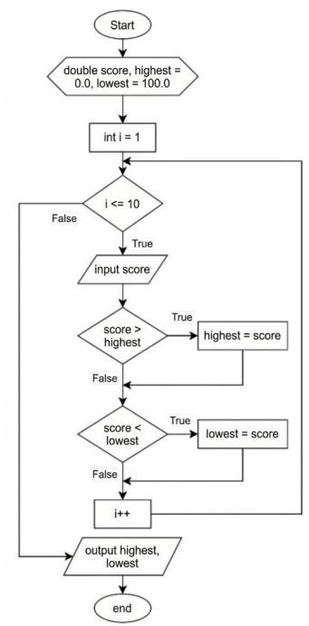
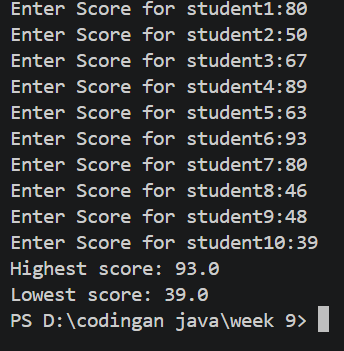
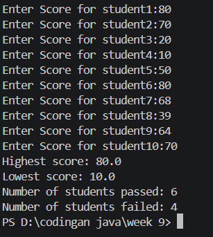
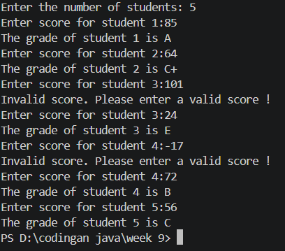
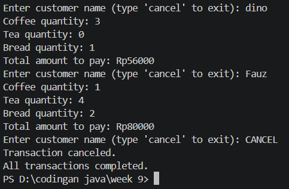
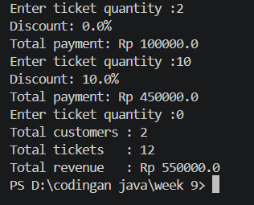
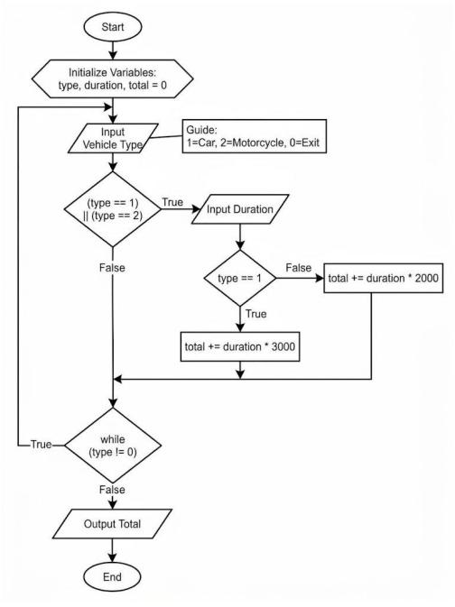
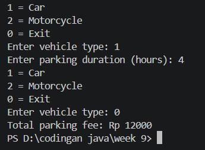

# Basic Programming Practicum Report
## Session 9: LOOPS 1

**Department of Information Technology — Politeknik Negeri Malang — 2026/2027**

</div>

| | |
|---|---|
| **Name** | Fauz Dino |
| **NIM** | 264107020241 |
| **Study Program** | D-IV Informatics Engineering |
| **Class** | 1I |

## Objectives

1. Students are able to explain the syntax for writing loop programs (`for`, `while`, and `do-while`).
2. Students are able to implement loop flowcharts using the Java programming language.

---

## Experiment 1: Student Grades Case Study in SIAKAD – FOR Loop

Flowchart:



Source code: `code/SiakadForAttendance13.java`
```java
import java.util.Scanner;
public class SiakadForAttendance13 {
    public static void main(String[] args) {
        Scanner sc = new Scanner(System.in);

        double score, highest = 0, lowest = 100;
        for (int i = 1; i <= 10; i++){
            System.out.print("Enter Score for student" + i + ":");
            score = sc.nextDouble();
            if (score > highest) {
                highest = score;
            }
            if (score < lowest) {
                lowest = score;
            }
        }
        System.out.println("Highest score: " + highest);
        System.out.println("Lowest score: " + lowest);
        
    sc.close();
    }
}

```
Output:



### Questions

**1. Identify and indicate each component of the FOR loop in the program code of Experiment 1!**

A `for` loop consists of three components: initialization (`int i = 1`), a condition (`i <= 10`), and an update/increment (`i++`). The loop prompts for each student's score and repeats 10 times.

**2. Why is `highest` initialized to 0 and `lowest` to 100? What happens if highest = 100 and lowest = 0?**

`highest` starts at 0 because no valid score can be lower than 0, so the first score entered will always replace it. `lowest` starts at 100 because no valid score can be higher than 100, so the first score will always replace it. If `highest = 100` and `lowest = 0`, the conditions `score > highest` and `score < lowest` can never be true, so the values would never be updated and the output would always be 100 and 0.

**3. Explain the function and workflow of the following code snippet!**

```java
if (score > highest) {
    highest = score;
}
if (score < lowest) {
    lowest = score;
}
```

- `if (score > highest)`: if the current score is higher than the highest score stored so far, `highest` is updated to the current score.
- `if (score < lowest)`: if the current score is lower than the lowest score stored so far, `lowest` is updated to the current score.

**4. Modify the program to count how many students pass and fail (minimum passing score 60).**

Added `pass` and `fail` counters (`score >= 60` → `pass++`, otherwise `fail++`) and displayed them after the highest and lowest scores.



---

## Experiment 2: Student Grades Case Study in SIAKAD – WHILE Loop

Source code: `code/SiakadWhileAttendance13.java`
```java
import java.util.Scanner;

public class SiakadWhileAttendance13 {
    public static void main(String[] args) {
        Scanner sc = new Scanner(System.in);
        
        int score, studentCount, i = 0 ;
        
        System.out.print("Enter the number of students: ");
        studentCount = sc.nextInt();

        while (i < studentCount) {
            System.out.print("Enter score for student " + (i + 1) + ":");
            score = sc.nextInt();

            if (score < 0 || score > 100) {
                System.out.println("Invalid score. Please enter a valid score !");
                continue;
            }
            if (score > 80 && score <=100) {
                System.out.println("The grade of student " + (i + 1 ) + " is A");
            }else if (score > 73 && score <= 100){
                System.out.println("The grade of student " + (i + 1) + " is B+");
            }else if (score > 65 && score <= 73){
                System.out.println("The grade of student " + (i +1 ) + " is B");
            }else if (score > 60 && score <= 65){
                System.out.println("The grade of student " + (i + 1) + " is C+");
            }else if (score > 50 && score <= 60){
                System.out.println("The grade of student " + (i + 1) + " is C");
            }else if (score > 39 && score <= 50){
                System.out.println("The grade of student " + (i + 1) + " is D");
            }else {
                System.out.println("The grade of student " + (i + 1) + " is E");
            }
            i++;
        
        }
    sc.close();
    }
}

```
Output:



### Questions

**1. Meaning and purpose of the syntax:**

- `score < 0 || score > 100` – the `||` operator means "OR"; if either condition is true, the score is considered invalid.
- `continue` – skips the remaining statements in the current iteration and goes to the next one, so an invalid value is never processed as a final value (and `i` is not incremented).

**2. Why is `i++` written at the end of the WHILE loop? What if it is at the beginning?**

`i++` increments the counter after the valid score has been processed. If it were at the beginning, the counter would increase before the score is processed, so the student numbers shown would be shifted and invalid inputs would still be counted.

**3. If the number of students is 19, how many times will the WHILE loop run?**

It processes 19 valid scores. It runs more than 19 times if invalid scores (below 0 or above 100) are entered, because each invalid score makes the program ask again for the same student.

**4. Modify the program so that grade A shows "Well done, keep up the good work!"**

```java
import java.util.Scanner;

public class SiakadWhileAttendance13 {
    public static void main(String[] args) {
        Scanner sc = new Scanner(System.in);
        
        int score, studentCount, i = 0 ;
        
        System.out.print("Enter the number of students: ");
        studentCount = sc.nextInt();

        while (i < studentCount) {
            System.out.print("Enter score for student " + (i + 1) + ":");
            score = sc.nextInt();

            if (score < 0 || score > 100) {
                System.out.println("Invalid score. Please enter a valid score !");
                continue;
            }
            if (score > 80 && score <=100) {
                System.out.println("The grade of student " + (i + 1 ) + " is A");
                System.out.println("Well done, keep up the good work!");
            }else if (score > 73 && score <= 100){
                System.out.println("The grade of student " + (i + 1) + " is B+");
            }else if (score > 65 && score <= 73){
                System.out.println("The grade of student " + (i +1 ) + " is B");
            }else if (score > 60 && score <= 65){
                System.out.println("The grade of student " + (i + 1) + " is C+");
            }else if (score > 50 && score <= 60){
                System.out.println("The grade of student " + (i + 1) + " is C");
            }else if (score > 39 && score <= 50){
                System.out.println("The grade of student " + (i + 1) + " is D");
            }else {
                System.out.println("The grade of student " + (i + 1) + " is E");
            }
            i++;
        
        }
    sc.close();
    }
}

```

---

## Experiment 3: Café Transaction Case Study – DO-WHILE Loop

Source code: `CafeDoWhileAttendance13.java`
```java
import java.util.Scanner;
public class CafeDoWhileAttendance13 {
    public static void main(String[] args) {
        Scanner sc = new Scanner(System.in);
        
        int  coffee, tea, bread;
        int coffeprice = 12000,
            teaprice = 7000,
            breadprice = 20000;
        int totalprice;
        String customername;

        do {
            System.out.print("Enter customer name (type 'cancel' to exit): ");
            customername = sc.nextLine();
            if (customername.equalsIgnoreCase("cancel")){
                System.out.println("Transaction canceled.");
                break;
            }
            System.out.print("Coffee quantity: ");
            coffee = sc.nextInt();
            System.out.print("Tea quantity: ");
            tea = sc.nextInt();
            System.out.print("Bread quantity: ");
            bread = sc.nextInt();
            totalprice = (coffee * coffeprice) + (tea * teaprice) + (bread * breadprice);
            System.out.println("Total amount to pay: Rp" + totalprice);
            sc.nextLine();
        }while (true); 
            
        System.out.println("All transactions completed.");
    sc.close();
    }
}
```
Output:



### Questions

**1. If the first customer name is `cancel`, how many times is the loop executed?**

Once. A do-while loop runs its body before checking the condition, and `break` ends the loop when `cancel` is entered.

**2. State the stopping condition.**

The loop stops when the customer enters `cancel`, which triggers the `break` statement.

**3. What is the function of `true` in the DO-WHILE condition?**

It makes the loop run indefinitely until it is stopped manually with `break` (when the user types `cancel`).

**4. Why does this loop still run without initialization and update components?**

A do-while loop does not require them; it only needs a condition. The program keeps running until `break` terminates it.

---

## Assignment

### 1. Cinema ticket sales

Source code: `assignment1.java`
```java
import java.util.Scanner;

public class assignment1 {
    public static void main(String[] args) {
        Scanner input = new Scanner(System.in);

        final int TICKET_PRICE = 50000;

        int ticketQuantity;
        int totalTickets = 0;
        int totalCustomers = 0;
        double totalRevenue = 0;

        while (true) {
            System.out.print("Enter ticket quantity :");
            ticketQuantity = input.nextInt();

            if (ticketQuantity == 0) {
                break;
            }

            if (ticketQuantity < 0) {
                System.out.println("Invalid input! Please try again.");
                continue;
            }

            double totalPrice = ticketQuantity * TICKET_PRICE;
            double discount = 0;

            if (ticketQuantity > 10) {
                discount = 0.15;
            } else if (ticketQuantity > 4) {
                discount = 0.10;
            }

            double finalPrice = totalPrice - (totalPrice * discount);

            totalTickets += ticketQuantity;
            totalRevenue += finalPrice;
            totalCustomers++;

            System.out.println("Discount: " + (discount * 100) + "%");
            System.out.println("Total payment: Rp " + finalPrice);
        }

        System.out.println("Total customers : " + totalCustomers);
        System.out.println("Total tickets   : " + totalTickets);
        System.out.println("Total revenue   : Rp " + totalRevenue);

        input.close();
    }
}
```
Rules: more than 4 tickets → 10% discount, more than 10 tickets → 15% discount, negative quantity → ask again.

Output:



### 2. Parking fee flowchart

Flowchart:



Source code: `assignment2.java`
```java
import java.util.Scanner;

public class assignment2{
    public static void main(String[] args) {
        Scanner input = new Scanner(System.in);

        int type, duration, total = 0;

        do {
            System.out.println("1 = Car");
            System.out.println("2 = Motorcycle");
            System.out.println("0 = Exit");
            System.out.print("Enter vehicle type: ");
            type = input.nextInt();

            if (type == 1 || type == 2) {
                System.out.print("Enter parking duration (hours): ");
                duration = input.nextInt();

                if (type == 1) {
                    total += duration * 3000;
                } else {
                    total += duration * 2000;
                }
            }

        } while (type != 0);

        System.out.println("Total parking fee: Rp " + total);

        input.close();
    }
}
```
Output:


